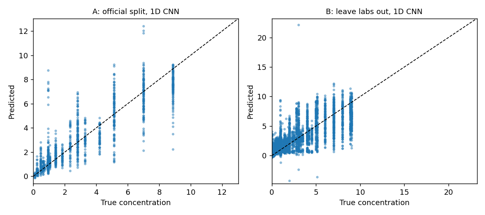

# Quantifying adenine from SERS spectra across laboratories

Predict the concentration of adenine from surface-enhanced Raman (SERS)
spectra, comparing PLS (the chemometrics standard), Ridge regression and a 1D
CNN. The evaluation protocol matters more than the model: besides the official
train/test split, every model is also tested on **laboratories it has never
seen**.

Context: preparation for a master's internship on computational Raman imaging.
This project covers spectral pre-processing, regression on spectra,
deep learning on 1D signals and the domain-shift problem.

## Data

[Fornasaro et al., Anal. Chem. 2020](https://zenodo.org/record/3572359):
interlaboratory SERS study of adenine, open access on Zenodo. 3,516 spectra,
15 laboratories, 4 substrates, 2 lasers (532 and 785 nm), 15 concentrations from
0 to 9. The code keeps the 355 wavenumbers (517 to 1,579 cm⁻¹) where all
spectra are complete.

## Run

```bash
python3 -m venv .venv
source .venv/bin/activate
pip install -r requirements.txt
python src/run.py --quick     # PLS and Ridge only, about 15 seconds
python src/run.py             # adds the 1D CNN, about 7 minutes on a laptop CPU
```

The 10 MB dataset is downloaded from Zenodo into `data/` on the first run.
Options: `--norm {none,snv,area}`, `--baseline` (remove the baseline first).
Outputs in `results/`: `results.md`, `predictions.png`, `preprocessing.png`.

## Results

Pre-processing: area normalisation, no baseline removal (chosen by the ablation below).

| Protocol | Model | RMSE | MAE | R² |
|---|---|---|---|---|
| A: official split | PLS (12 latent variables) | 1.827 | 1.350 | 0.571 |
| A: official split | Ridge | 1.810 | 1.340 | 0.579 |
| A: official split | **1D CNN** | **1.382** | **0.928** | **0.754** |
| B: leave labs out | PLS | 2.360 | 1.682 | 0.261 |
| B: leave labs out | Ridge | 2.173 | 1.590 | 0.374 |
| B: leave labs out | **1D CNN** | **1.951** | **1.397** | **0.495** |

- Protocol A: train and test sets share the same laboratories (different samples).
- Protocol B: 5 folds grouped by laboratory, test laboratories unseen in training.
- Concentrations range from 0 to 9, so an RMSE of 1.95 is about 22 % of the range.



**Reading the results.** The CNN is the best model under both protocols, and
all models lose a lot when the laboratory changes (CNN R² from 0.75 to 0.50).
That gap is the instrument-to-instrument variability of SERS, the central
difficulty of the field. Results come from one seed; differences of a few
percent should not be over-interpreted.

## Ablation: does pre-processing matter?

Protocol B, R² (PLS / Ridge), with the CNN left out for speed:

| Normalisation | With AsLS baseline removal | Without |
|---|---|---|
| none | -1.23 / -1.50 | -2.37 / -0.94 |
| SNV (zero mean, unit variance) | 0.17 / 0.21 | 0.30 / 0.37 |
| area (unit L1 norm) | 0.18 / 0.23 | **0.26 / 0.37** |

Two clear findings: **normalisation is essential** across laboratories (without
it the models are worse than predicting the mean, R² < 0), and **baseline
removal with fixed AsLS parameters does not help** here, probably because the
broad background carries information about the substrate and the amount of
material. A per-instrument tuning of the baseline might change that; it was not
tested.

## Documentation

[docs/method.md](docs/method.md): why SERS quantification is hard, data, pre-processing, models, evaluation protocols and what is not done.

## Limits and next steps

- Single seed and no confidence intervals; single CNN configuration.
- No calibration transfer between instruments (standardisation, domain adaptation), the usual remedy for the A to B gap.
- Per-substrate or per-laser models, and denoising before regression, were not explored.
- Natural continuation toward computational Raman imaging: spectral unmixing
  and denoising of hyperspectral images, with the same pre-processing and models.

Data: Fornasaro S. et al., Anal. Chem. 92(5), 2020, Zenodo 3572359.
